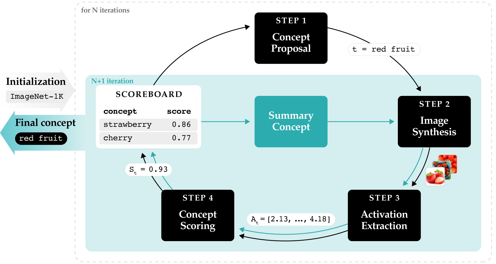

<div align="center">

# LINE: LLM-based Iterative Neuron Explanations for Vision Models 
Vladimir Zaigrajew, Michał Piechota, Gaspar Sekula, Paweł Gelar, Przemysław Biecek

</div>

## Abstract
Interpreting the concepts encoded by individual neurons in deep neural networks is a crucial step towards understanding their complex decision-making processes and ensuring AI safety. Despite recent progress in neuron labeling, existing methods often limit the search space to predefined concept vocabularies or produce overly specific descriptions that fail to capture higher-order, global concepts. We introduce LINE, a novel, training-free iterative approach tailored for open-vocabulary concept labeling in vision models. Operating in a strictly gray-box setting, LINE leverages a large language model and a text-to-image generator to iteratively propose and refine concepts in a closed loop, guided by activation history. We demonstrate that LINE achieves state-of-the-art performance across multiple model architectures, yielding AUC improvements of up to 0.15 on ImageNet and 0.05 on Places365, while discovering, on average, 25% of new concepts missed by predefined vocabularies. Beyond identifying the top concept, LINE provides a complete generation history, enabling polysemanticity evaluation and producing supporting visual explanations that rival gradient-dependent activation maximization methods.

[](https://arxiv.org/abs/2604.08039)

<p align="center"></p>

## 💻 System Requirements

#### Hardware

To achieve the best results with the recommended settings, the following hardware is required:

* **GPU:** At least **32 GB VRAM** (the paper settings peak at ~31 GB; `--model_swapping` keeps only one model on the GPU at a time)
* **RAM:** At least **32 GB**
* **CPU:** 1x Core (minimum)

> [!NOTE]
> You can run smaller configurations (e.g., Llama-3.2-1B-Instruct + SDXL-Turbo) with **12 GB RAM**, but the explanation quality will be significantly lower.

#### Software & Environment

* **Python:** Versions and dependencies are managed via `pyproject.toml`.
* **Package Manager:** We strongly recommend using [UV](https://docs.astral.sh/uv/) for fast, reliable dependency management.
* **Lockfile:** The exact environment used in our experiments is provided in `uv.lock`.

## 🚀 Installation & Setup

Follow these steps to get the environment ready:

1. Clone the Repository

    ```bash
    git clone https://github.com/CredibleAI/LINE.git
    cd LINE
    ```

2. Configure Environment Variables

   Copy `.env.example` to `.env` and fill in the values. `uv run` does not read `.env` by itself, so point it at the file:

   ```bash
   cp .env.example .env
   export UV_ENV_FILE=.env  # every `uv run` below loads .env
   ```

   | Variable | Description |
   | --- | --- |
   | `HF_TOKEN` | Hugging Face token, required for the gated Llama models and ImageNet |
   | `HF_HOME` | Hugging Face cache directory (optional) |
   | `TORCH_HOME` | PyTorch cache directory (optional) |
   | `DATA_DIR` | Data directory used by `download_imagenet.py` and the SLURM script (default: `./data`) |
   | `SAVE_DIR` | Output directory of the SLURM script (default: `results`) |

3. Data Preparation

   LINE seeds each neuron's search with ImageNet classes, so the first run needs the ImageNet-1K validation set to compute the control activations. Accept the terms of [ILSVRC/imagenet-1k](https://huggingface.co/datasets/ILSVRC/imagenet-1k) on Hugging Face, then download it to `$DATA_DIR/ImageNet-1K`:

   ```bash
   uv run download_imagenet.py
   ```

## 🛠 Usage

#### Run the Pipeline

To start the explanation process with default settings:

```bash
uv run main.py \
  --explained_model resnet18 \
  --neurons "avgpool:0,1,2" \
  --imagenet_data_path data/ImageNet-1K \
  --control_activations_path data/control_activations
```

The first run for a (model, layer) pair computes its control activations from `--imagenet_data_path` and caches them in `--control_activations_path`; later runs only read the cache.

#### Paper Settings 

For optimal performance and insight quality, use the following configuration:

* **T2I Model:** Stable Diffusion XL Base 1.0
* **LLM:** Llama-3.1-8B-Instruct

**Run command:**

```bash
uv run main.py \
  --explained_model resnet18 \
  --neurons "avgpool:0,1,2" \
  --imagenet_data_path data/ImageNet-1K \
  --control_activations_path data/control_activations \
  --language_model meta-llama/Llama-3.1-8B-Instruct \
  --t2i_model stabilityai/stable-diffusion-xl-base-1.0
```

#### Configuration Options

| Option | Description | Default Value |
| --- | --- | --- |
| `--t2i_model` | ID of the text-to-image model. Supported: `stabilityai/stable-diffusion-xl-base-1.0`, `stabilityai/sdxl-turbo`, `black-forest-labs/FLUX.1-dev`, `stable-diffusion-v1-5/stable-diffusion-v1-5`. | `stabilityai/stable-diffusion-xl-base-1.0` |
| `--explained_model` | Model to explain. Supported: `resnet18`, `resnet50` (Places365 weights), `resnet18\|imagenet`, `resnet50\|imagenet`, `vit_b_16` (ImageNet weights), `resnet50\|robust` (adversarially robust ImageNet ResNet50), `dinov3-vitb16`. | `resnet18` |
| `--language_model` | LLM for concept generation (Meta-Llama series). | `meta-llama/Llama-3.1-8B-Instruct` |
| `--neurons` | Neurons to explain as space-separated `layer:id,id,...` entries. Example: `--neurons avgpool:0,1,2 layer4:5,10`. | `avgpool:0` |
| `--n_iters` | Number of pipeline iterations. | `10` |
| `--num_img` | Images to generate per concept per iteration. | `5` |
| `--num_inf_steps` | Number of inference steps for image generation (`None` = model default). | `None` |
| `--guidance_scale` | Guidance scale for the diffusion model (`None` = model default). | `None` |
| `--t2i_batch_size` | Batch size for T2I image generation (`0` = full batch at once, which runs out of memory with the defaults even on an 80 GB GPU). | `1` |
| `--llm_batch_size` | Batch size for LLM inference (`0` = no batching). | `0` |
| `--explained_model_batch_size` | Batch size for the explained model forward pass (`0` = no batching). | `0` |
| `--model_swapping` | Swap models between CPU and GPU to reduce peak VRAM usage. | `False` |
| `--metric` | Scoring metric for concepts. | `AVG_ACTIVATION` |
| `--top_k` | Number of top concepts passed to the LLM in the final summary step. | `3` |
| `--prompt_path` | Path to the prompt template file for LLM concept generation. | bundled `prompt_main.txt` |
| `--summary_prompt_path` | Path to the prompt template file for LLM summary generation. | bundled `prompt_summary.txt` |
| `--prompt_text` | Base prompt prefix used when generating images. | `A realistic photo of a` |
| `--max_new_tokens` | Maximum number of tokens to generate per LLM response. | `256` |
| `--h_size` | Maximum scoreboard size during iterative updates (`0` = unbounded). | `0` |
| `--initial_h_size` | Number of concepts to seed the scoreboard with at startup (`0` = use all). | `10` |
| `--best_ratio` | Fraction of scoreboard slots filled with top-scoring concepts. | `0.5` |
| `--init_pool_ratio` | Fraction (0, 1] of the control-concept classes available to seed the scoreboard (`1.0` = all). | `1.0` |
| `--control_activations_path` | Directory where pre-computed control activations are stored. | `control_activations` |
| `--imagenet_data_path` | Path to ImageNet-style images for computing control activations. | `None` |
| `--deterministic_llm` | Use greedy decoding for the LLM (`do_sample=False`) instead of sampling. Produces reproducible outputs at the cost of response diversity. | `False` |
| `--seed` | Random seed for reproducibility. | `42` |
| `--save_images` | Save generated images from each iteration to disk. | `False` |
| `--save_histories` | Save generation and concept history to disk. | `False` |
| `--save_dir` | Directory where pipeline artifacts are stored. | `results` |
| `--device` | Device to run the pipeline on: `cuda` or `cpu` (select a GPU with `CUDA_VISIBLE_DEVICES`). | `cuda` |

> [!NOTE]
> The default prompt templates (`prompt_main.txt` and `prompt_summary.txt`) are bundled with the package under `src/line/prompts/`. Custom templates can be supplied via `--prompt_path` and `--summary_prompt_path`; both files must exist at the given paths before the pipeline starts.

*For a full list of parameters, run `uv run main.py --help` or check the [src/line/config.py](src/line/config.py).*

## 🧠 Sampling Random Neurons (`sample_neurons.py`)

`sample_neurons.py` is a utility script for randomly selecting a subset of neurons to explain from a given model layer. It is used to pick a reproducible random subset before passing them to `main.py`.

```bash
NEURONS=$(uv run sample_neurons.py \
  --explained_model resnet50 \
  --layer avgpool \
  --n 100 \
  --seed 42)

uv run main.py --neurons "$NEURONS" ...
```

## ⚡ Running on SLURM

[slurm/line_array.sh](slurm/line_array.sh) runs LINE as a SLURM array over the (model, layer) pairs of the paper, the layers in `assets/explanations/LINE`. Neurons are sampled with `sample_neurons.py`, and each pair is split into array tasks of `CHUNK_SIZE` neurons. Add your cluster's account and partition to the `#SBATCH` header if it needs them, then submit from the repository root:

```bash
mkdir -p slurm/logs
sbatch slurm/line_array.sh                                         # SDXL, as in the paper
T2I_MODEL=black-forest-labs/FLUX.1-dev sbatch slurm/line_array.sh  # FLUX.1-dev
```

The run is controlled by these environment variables, which can also be set in `.env` (values given at submission, as in `SAVE_DIR=... sbatch ...`, take precedence):

| Variable | Description | Default |
| --- | --- | --- |
| `T2I_MODEL` | Text-to-image model | `stabilityai/stable-diffusion-xl-base-1.0` |
| `LANGUAGE_MODEL` | LLM for concept generation | `meta-llama/Llama-3.1-8B-Instruct` |
| `N_NEURONS` | Random neurons to explain per (model, layer) | `100` |
| `CHUNK_SIZE` | Neurons per array task | `50` |
| `NEURON_SEED` | Seed for neuron sampling | `42` |
| `NUMBER_OF_IMAGES` | Images per concept per iteration | `5` |
| `NUMBER_OF_ITERATIONS` | Pipeline iterations | `10` |
| `H_SIZE` | Scoreboard size (`0` = unbounded) | `0` |
| `T2I_BATCH_SIZE` | Batch size for image generation | `1` |
| `NUM_INF_STEPS` | Diffusion steps (empty = model default) | empty; `1` for `stabilityai/sdxl-turbo` |
| `DATA_DIR` | Root directory for ImageNet and the control activations | `./data` |
| `SAVE_DIR` | Root directory for output artifacts | `results` |

The `--array` range must cover (number of pairs) × ⌈`N_NEURONS` / `CHUNK_SIZE`⌉ tasks: 26 × 2 = 52 with the defaults (`--array 0-51`). Update it if you change the pairs, `N_NEURONS` or `CHUNK_SIZE`.

> [!IMPORTANT]
> **Compute control activations before fanning out jobs.** Every run computes the control activations for its `(model, layer)` pairs if they are not in `--control_activations_path` yet. Each layer directory is written atomically, so the cache never holds partial data. However, if several jobs start on an empty cache at the same time, they all compute the same activations. The first to finish keeps its copy, and the others fail with `OSError` after the full computation. Resubmitting a failed job works, because it finds the finished cache and skips the computation. To avoid wasting the compute, fill the cache with a single process before submitting the array:
>
> ```bash
> uv run python - <<'EOF'
> from pathlib import Path
>
> import torch
>
> from explained_models import get_model
> from line.pipeline.initialization import ensure_control_activations, get_model_layer_activations_path
> from transform_images import get_transform
>
> MODEL, LAYERS = "resnet50|imagenet", ["avgpool"]  # Match --explained_model and the layers in --neurons.
> IMAGENET, CACHE = Path("data/ImageNet-1K"), Path("data/control_activations")  # --imagenet_data_path, --control_activations_path
>
> model = get_model(MODEL, layers=LAYERS, device=torch.device("cuda"), model_swapping=False, transforms=get_transform(MODEL))
> ensure_control_activations(IMAGENET, {layer: get_model_layer_activations_path(CACHE, MODEL, layer) for layer in LAYERS}, model)
> EOF
> ```
>
> Alternatively, submit one job first and chain the rest behind it with `sbatch --dependency=afterok:<job_id>`. Once the cache exists, jobs only read it and can run concurrently.

## 📈 Paper Explanations

The explanations evaluated in the paper are in [assets/explanations/](assets/explanations/), scored with [CoSy](https://github.com/lkopf/cosy). The full LINE search behind each LINE explanation is in [assets/histories/](assets/histories/). [notebooks/paper_results.ipynb](notebooks/paper_results.ipynb) recreates the paper's CoSy tables and figures from these files:

```bash
uv run --extra notebooks --with jupyter jupyter lab notebooks/
```

To score your own LINE runs, export each run's final concepts as a CoSy explanation CSV (`layer,unit,description`) and evaluate it with the CoSy repository.

#### `assets/explanations/<METHOD>/<model>-<layer>.csv`

One row per explained neuron, in the CoSy explanation format plus the evaluation scores:

| Column | Description |
| --- | --- |
| `layer` | Layer name as CoSy knows it (e.g. `avgpool`, `ln`, `encoder_layer_6`). |
| `unit` | Neuron index within the layer. |
| `description` | The method's explanation of the neuron. |
| `AUC` | CoSy AUC of the explanation (higher is better). |
| `MAD` | CoSy mean activation difference (higher is better). |
| `Corr` | Pearson correlation between the neuron's activations and the SigLIP similarity of each image to `description` (higher is better; the paper reports it ×10⁻¹). |

| Method | Explanations |
| --- | --- |
| `LINE` | LINE with SDXL (the default T2I model). |
| `LINE_flux` | LINE with FLUX.1-dev, headline layers only. |
| `CLIP-Dissect` | CLIP-Dissect, run on the full layer. |
| `INVERT` | INVERT with single-concept explanations (formula length 1). |
| `DnD` | Describe-and-Dissect. |

All methods explain the same randomly sampled neurons: 100 per layer, or all 64 neurons of ResNet18 `layer1`. `resnet18`, `resnet50` and `vit_b_16` are ImageNet models; `resnet18_places` and `resnet50_places` are Places365 models, evaluated on Places365; `dinov3-vitb16` is DINOv3 (LVD-1689M). Note that the file names follow CoSy, not `--explained_model`: `resnet18` here is `--explained_model "resnet18|imagenet"`, `resnet18_places` is `--explained_model resnet18`, and likewise for `resnet50`.

#### `assets/histories/<METHOD>/<model>-<layer>.csv`

For `LINE` and `LINE_flux`, every concept LINE scored for every neuron in `assets/explanations/`:

| Column | Description |
| --- | --- |
| `layer`, `unit` | As above. |
| `iteration` | `0` for the initial vocabulary pool, `1`–`10` for the LLM iterations, `11` for the summary call. |
| `stage` | `initial`, `iteration` or `summary`. |
| `concept` | The concept (newlines replaced by spaces, as in `description`). |
| `score` | Mean activation of the neuron on the concept's generated images. |

The final scoreboard holds every concept with its score, and its top concept is the reported `description`. Images are generated from fixed seeds, so a concept proposed more than once gets the same images and the same score each time.

#### `assets/dexter/`

The inputs of the paper's comparison with DEXTER and DiffExplainer on the robust ResNet50 (`resnet50|robust`), which [notebooks/dexter_comparison.ipynb](notebooks/dexter_comparison.ipynb) recreates. Each of the six ImageNet classes has a `<label>/` folder with five neurons:

| File | Content |
| --- | --- |
| `<label>/DEXTER_<column>.jpg`, `<label>/DiffExplainer_<column>.jpg` | The image each method produced for the neuron in that column. |
| `<label>/SalientImageNet_<column>.jpg` | The neuron's heatmap from Salient ImageNet (an ImageNet photo with the heatmap overlaid). |
| `<label>/LINE/neuron_<id>/image_<k>.jpeg` | LINE's five generated images of the neuron's reported concept. |
| `concepts.csv` | `label, class_name, column, neuron, concept`: the neurons in column order and their LINE concepts. |

The DEXTER, DiffExplainer and Salient ImageNet images were provided on request by the authors of [DEXTER](https://arxiv.org/abs/2510.14741) (see [Acknowledgements](#-acknowledgements)). The robust ResNet50 weights are downloaded to `$DATA_DIR/models/` on the first run.

## 🧩 Adding New Explained Models

The explained models used in paper live in [explained_models.py](explained_models.py). If you want to add a new model, follow these steps:

**1. Subclass `ExplainedModel`** from `line.models.base` and implement two methods:

- `_load()` — load your model and return it (`.eval()`, moved to `self._device`).
- `_pool_activations(activations)` — reduce raw hook output to shape `(N, num_neurons)`.
  - For CNN layers with shape `(N, C, H, W)`: spatial mean pool → `activations.mean(dim=[2, 3])`.
  - For transformer layers with shape `(N, seq_len, dim)`: extract the CLS token → `activations[:, 0]`.

**2. Register the model ID** by adding it to the appropriate ID tuple in `explained_models.py` and handling it in the `get_model()` factory function. The ID format is `{model_name}` or `{model_name}|{dataset}` (e.g., `resnet50` or `resnet50|imagenet`). The dataset part is optional and only used for models with multiple variants (e.g., robust vs. standard ResNet-50).

After that, pass your ID to `--explained_model` when running `main.py` to explain neurons from your new model.

> [!NOTE]
> The `transforms` argument (default: `transform_images` from [transform_images.py](transform_images.py)) converts PIL images to model input tensors. Supply a custom callable if your model expects different preprocessing.


## 🙏 Acknowledgements

We thank Simone Carnemolla, Matteo Pennisi, Sarinda Samarasinghe, Giovanni Bellitto, Simone Palazzo, Daniela Giordano, Mubarak Shah and Concetto Spampinato, the authors of [DEXTER: Diffusion-Guided EXplanations with TExtual Reasoning for Vision Models](https://arxiv.org/abs/2510.14741), for providing images used in our comparison with DEXTER (`assets/dexter/`).

## 📑 Citation
If you use this repository in your research, please cite it as:
```bibtex
@inproceedings{
anonymous2026line,
title={{LINE}: {LLM}-based Iterative Neuron Explanations for Vision Models},
author={Zaigrajew, Vladimir and Piechota, Micha{\l} and Sekula, Gaspar and Gelar, Pawe{\l} and Biecek, Przemys{\l}aw},
booktitle={The Fortieth Annual Conference on Neural Information Processing Systems},
year={2026},
url={https://openreview.net/forum?id=Cyqy5Yh0Ho}
}
```
